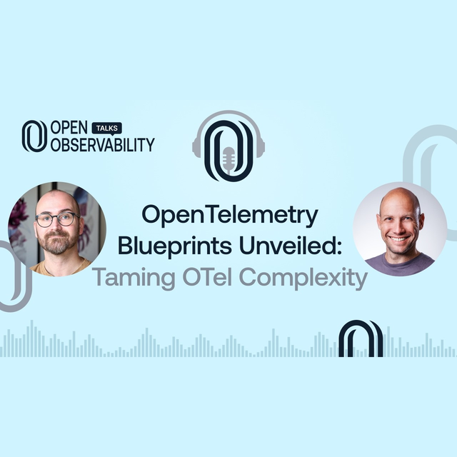

---
date:
  created: 2026-06-27
  updated: 2026-06-27
pin: false
categories:
  - Podcasts
tags:
  - OpenObservability Talks
  - OpenTelemetry
  - OTel Blueprints
slug: openobservability-talks-2026
cSpell:ignore: dotan horovits openobservability
---

# OpenObservability Talks

I joined [Dotan Horovits](https://www.linkedin.com/in/horovits/) on
[OpenObservability Talks](https://www.youtube.com/watch?v=X19BPLrYkUM) to introduce OTel Blueprints: practical
reference architectures to help platform engineering, SRE and application teams cut through the complexity of deploying
OpenTelemetry at scale. We talked about end-user adoption pains, how organisation structure shapes adoption patterns, and
walked through the first blueprints for traditional infrastructure, Kubernetes workloads and Kubernetes monitoring.
